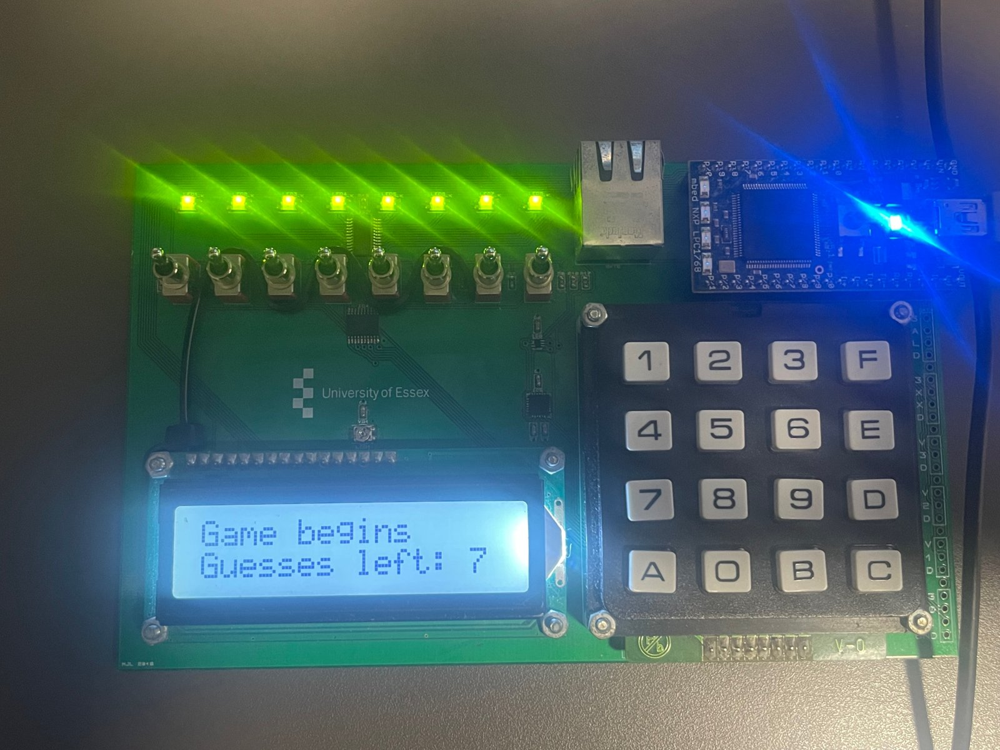
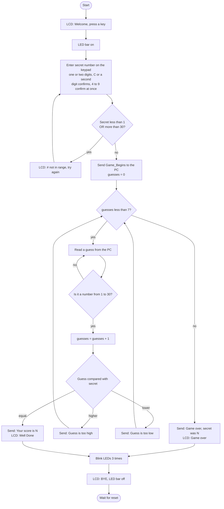
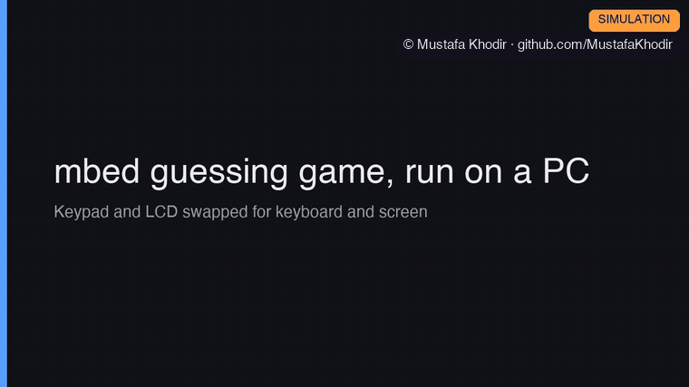

# Embedded C: mbed Guessing Game and Keyword Counter

Two C programs. The first is a guessing game that runs on an ARM mbed board and talks to a PC over a serial link, with the keypad, LCD and LED bar on the board all doing a job. The second is a command line tool that scans a large text file and counts how many times each word from a keyword list appears, using a linked list so everything is matched in one pass.



## What it does

### Guessing game

- The player sets a secret number between 1 and 30 on the board's keypad. A second digit confirms it, and so does a single 4 to 9, since nothing from 40 up is in range. Anything outside the range gets "# not in range" on the LCD and they try again.
- The LED bar comes on to show the game is live, and the board prints Game_Begins down the serial link so the PC program knows to start.
- A second player on the PC types guesses. Each one goes to the board over UART at 9600 baud, and the board answers "too high", "too low" or "Your score is N", where N is how many guesses it took.
- There are seven guesses. During the game the LCD shows "Game begins" on the top row and the guesses left on the bottom row.
- When the game ends the LEDs flash, the LCD shows the score with "Well Done :)" or the game over message, and then "BYE" and "BYE:)". Press reset on the board to play again.

### Keyword counter

- Asks for two file names: a keyword list (one word per line) and the text to search. Press Enter to use the sample files in the data folder.
- Counts whole word matches only, so "prison" does not match inside "imprisoned".
- Prints a table sorted by count, highest first, and writes the same table to Results.txt, along with how long the search took.

On the sample text, which is a 361 KB file of film reviews, the twelve keywords are counted in about 0.04 seconds.

## My role

Both programs are solo work. I designed the game flow and the flowchart, wrote the board code and the PC code, wired up the game to the keypad, LCD and LED bar, and tested it on the real board. For the keyword counter I chose the linked list design and the one pass matching approach and wrote all the code.

## How it works

### Guessing game, board side

The board code is in `guessing_game/mbed_game.cpp`, written for the mbed online compiler with the mbed and TextLCD libraries.

The keypad has 16 keys in 4 rows and 4 columns. The code picks a column by writing its number, 0 to 3, as a binary value on the three column select lines, then checks the four row lines, so three lines are enough to scan all four columns. A lookup table turns the row and column into the character printed on the key. Writing a 16 bit pattern to the shift register lights the LED bar.

| Part | Signal | mbed pin |
| --- | --- | --- |
| 4 by 4 keypad | Column select, column number 0 to 3 in binary | p26, p25, p24 |
| 4 by 4 keypad | Row inputs | p14, p13, p12, p11 |
| 16 by 2 LCD | RS | p15 |
| 16 by 2 LCD | E | p16 |
| 16 by 2 LCD | D4 to D7 | p17, p18, p19, p20 |
| LED bar shift register | SPI MOSI, MISO, SCLK | p5, p6, p7 |
| LED bar shift register | Chip select | p8 |
| PC serial link | TX, RX | USBTX, USBRX |

The serial port to the PC is the board's USB link. The board reads a whole line, checks it really is a number and that it is in range, then compares it with the secret and sends the hint back.



### Serial messages

An example exchange, using the exact strings in the board code and the PC program. Lines from the board are marked board, lines typed on the PC are marked PC.

```text
board: Game_Begins
board: Enter your guess:
PC:    20
board: Guess is too high.
board: Enter your guess:
PC:    12
board: Guess is too low.
board: Enter your guess:
PC:    16
board: Your score is 3.
```

If the PC sends something that is not a clean number, including a number with extra characters after it like 12abc, the board answers "That is not a number, try again.", and a number outside 1 to 30 gets "Number not in range (1 to 30), try again.". Neither counts as a guess.

### Guessing game, PC side

`guessing_game/pc_host.c` opens the serial port using the rs232 library, waits for the Game_Begins line, then loops: ask for a guess, send it, print the board's answer. Serial text can arrive in pieces, so it collects each reply until the board has finished it before acting on it. It stops when it sees "Your score is" or "Game over".

### Keyword counter

`task_handler/task_handler.c` keeps the keywords in a doubly linked list. Each node holds the word, a count, and an index that records how much of the word has been matched so far. The search reads the big file one character at a time and feeds every character to every keyword's matcher, so the file is only read once no matter how many keywords there are. A match only counts when the character before the word and the character after it are not letters. At the end the list is sorted by count by repeatedly pulling out the node with the biggest count.

## Source code

The source code is private and available on request. Contact me at mkhodir77@gmail.com.

## What's in this repo

- `media/` photos of the board at each stage of the game and an overview of the screens.
- `media/demo/` the demo recordings, GIFs to watch here and one MP4 with captions.

## Demo

**Keyword counter.** A real run on the sample files: 12 keywords counted across a 361 KB text file in about 0.05 seconds.


**Guessing game, run on a PC (simulation).** mbed_game.cpp compiled for a PC with the game logic unchanged. The keypad is read from the keyboard, and the LCD, LED bar and serial link are drawn from what the code writes to them.



Both with captions:

https://github.com/user-attachments/assets/d93678b9-f9b9-4661-b3a5-68a21a654b3b

The same video is in the repo as [embedded-c-demo.mp4](media/demo/embedded-c-demo.mp4) (50 s). Background music in the MP4 is an 8 bit chiptune track, synthesised from scratch for these demos and released as CC0.

Video of the game on the real board: Google Drive link: (add link here)

The full project report is available on request.

Copyright 2026 Mustafa Khodir. All rights reserved.
